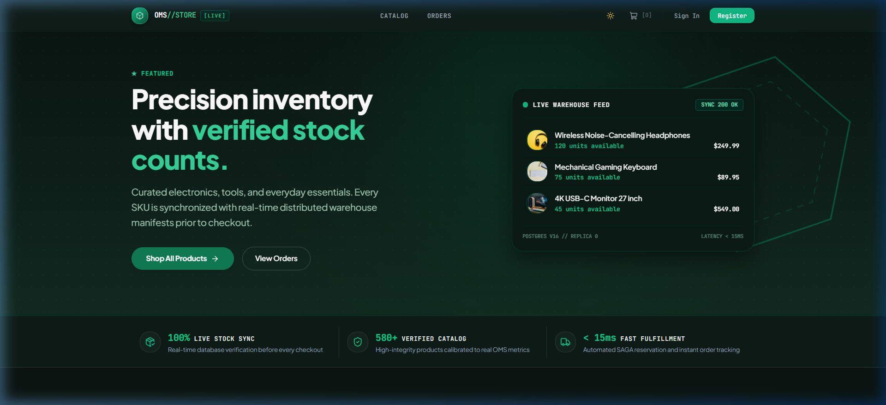
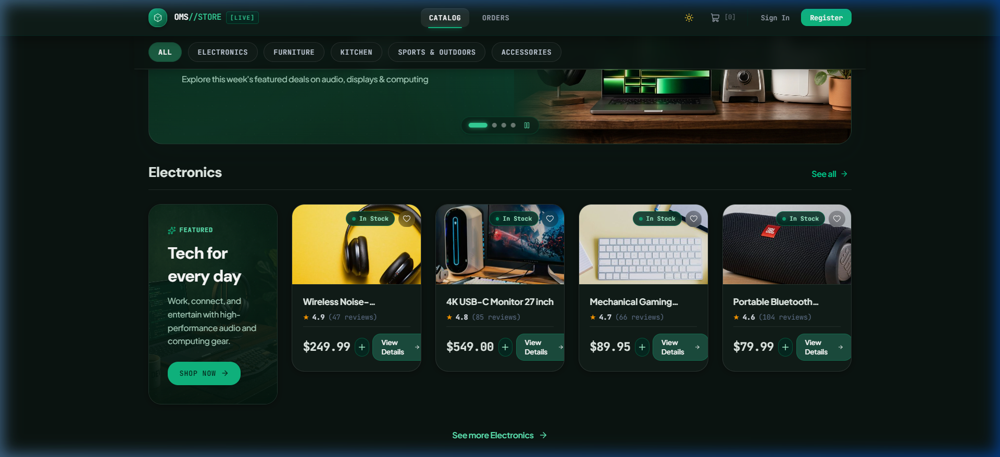
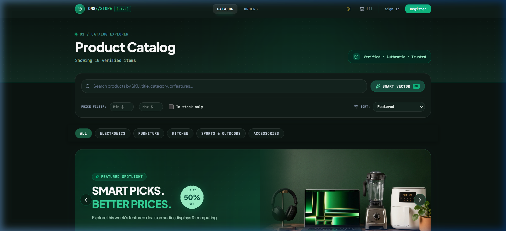
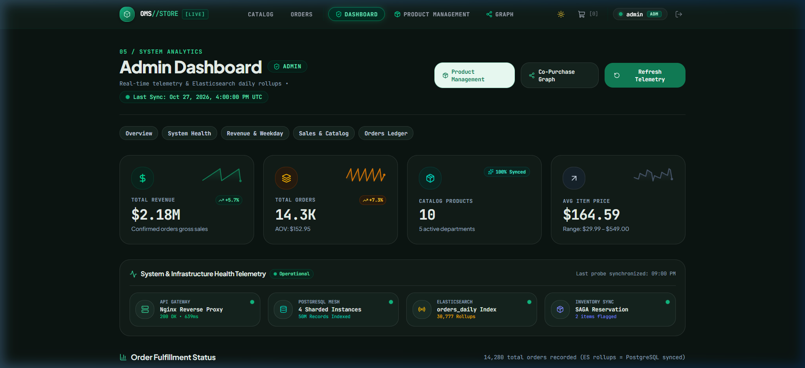
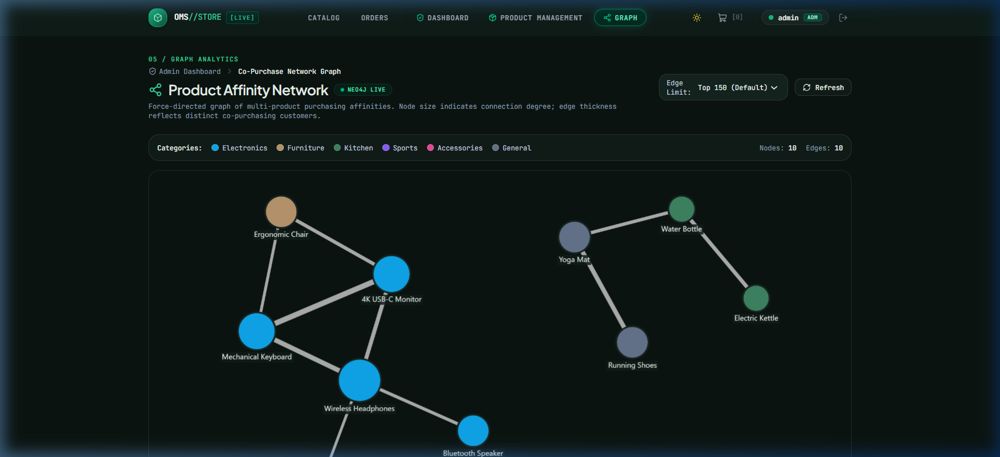
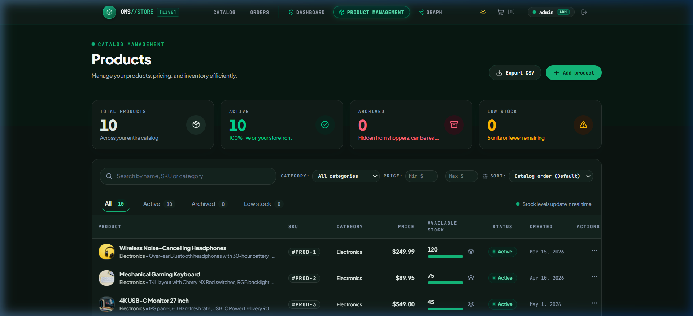
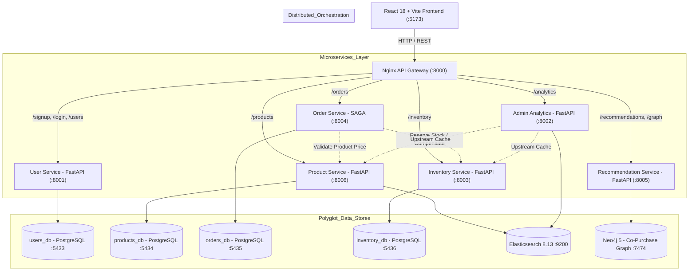

# 🛒 Distributed E-Commerce Order Management System (OMS)

[](https://fastapi.tiangolo.com)
[](https://react.dev)
[](https://vitejs.dev)
[](https://www.postgresql.org)
[](https://www.elastic.co)
[](https://neo4j.com)
[](https://www.docker.com)
[](https://locust.io)

An enterprise-grade, polyglot distributed Order Management System built with **6 FastAPI microservices**, an **Nginx API Gateway**, **4 isolated PostgreSQL databases**, **Elasticsearch 8.13**, **Neo4j Graph Database**, and a modern **React 18 (Vite)** single-page application.

---

## 📸 Demo UI Showcase

### 🛍️ Storefront & Shopper Experience

#### 1. Storefront & Live Telemetry Feed
High-contrast modern interface featuring real-time warehouse sync feeds, verified catalog badges, and instant checkout orchestration:


#### 2. Category-Sectioned Catalog & Metro Visual Tiles
Editorial catalog browsing with responsive category navigation, promotional hero tiles, real-time stock pills, ratings, and immediate cart actions:


#### 3. Smart Search & Filter Control Hub
Elasticsearch-powered fuzzy text search with vector similarity toggle, price range filters, stock availability toggles, and sorting:


---

### 🛡️ Admin Portal & Graph Intelligence

#### 4. Executive Analytics Dashboard & System Health Telemetry
Real-time operations command center with period-over-period KPI sparklines, Elasticsearch daily rollup metrics, revenue trends, and operational cluster health (Nginx Gateway, PostgreSQL mesh, Elasticsearch indices, and SAGA reservation status):


#### 5. Neo4j Product Affinity & Co-Purchase Network Graph
Interactive force-directed graph powered by Cytoscape.js and Neo4j Cypher queries. Node sizing represents product connection degree, and edge thickness reflects distinct co-purchasing customers across historical transactions:


#### 6. Product Catalog & Live Stock Allocation Management
Dedicated admin catalog management dashboard featuring live SKU tracking, stock level visual progress bars, instant CSV export, soft-archiving, and synchronized inventory adjustment controls:


---

## 🏗️ Architecture & Component Topology

The system enforces strict microservice boundaries. No microservice accesses another service's private PostgreSQL database directly. All cross-boundary workflows are coordinated via HTTP through the central API Gateway or internal service keys.



---

## ⚡ Core Distributed Features

| Feature | Technical Implementation |
|---|---|
| **Distributed SAGA Orchestration** | Two-phase compensating transactions across `order-service` and `inventory-service`. If payment/validation fails after inventory reservation, automated compensating calls roll back stock deductions immediately. |
| **Order Idempotency** | Header-driven `Idempotency-Key` tracking protected by PostgreSQL unique constraints to eliminate duplicate order charges under network retries. |
| **Anti-Overselling & Concurrency** | Pessimistic row-level locking (`SELECT ... FOR UPDATE`) in `inventory-service` ensures race-condition immunity even during flash-sale spikes. |
| **Bloom Filter Accelerated Uniqueness** | `user-service` uses an in-memory Bloom filter for $O(1)$ fast rejection of taken usernames before querying `users_db`. |
| **Hybrid & Semantic Search** | Elasticsearch 8.13 powers BM25 full-text search, dense vector kNN semantic matching (cosine similarity thresholding), and auto-complete suggestions. |
| **Graph Collaborative Recommendations** | Neo4j Cypher queries evaluate customer co-purchasing patterns to generate real-time product recommendations and network topology graphs. |
| **Elasticsearch Daily Rollups** | `admin-analytics` runs background sync tasks and Elasticsearch aggregations for daily revenue trends and order status rollups without locking operational OLTP tables. |
| **Stateless JWT & HMAC Service Mesh** | Secure user authentication with Role-Based Access Control (`customer` vs `admin`) and constant-time HMAC `X-Service-Key` verification for internal service-to-service calls. |

---

## 🌐 Access Points & Service Directory

| Service | Protocol / URL | Port | Purpose / Documentation |
|---|---|---|---|
| **API Gateway (Nginx)** | `http://localhost:8000` | 8000 | Reverse proxy and single entry point |
| **React Frontend** | `http://localhost:5173` | 5173 | User storefront and admin portal |
| **User Service** | `http://localhost:8001` | 8001 | User registration, Bloom filter, JWT auth ([Swagger Docs](http://localhost:8001/docs)) |
| **Admin Analytics** | `http://localhost:8002` | 8002 | Daily ES rollups & catalog statistics ([Swagger Docs](http://localhost:8002/docs)) |
| **Inventory Service** | `http://localhost:8003` | 8003 | Live stock tracking & pessimistic locks ([Swagger Docs](http://localhost:8003/docs)) |
| **Order Service (SAGA)** | `http://localhost:8004` | 8004 | Distributed SAGA orchestrator & idempotency ([Swagger Docs](http://localhost:8004/docs)) |
| **Recommendation Service** | `http://localhost:8005` | 8005 | Neo4j co-purchase graphs ([Swagger Docs](http://localhost:8005/docs)) |
| **Product Service** | `http://localhost:8006` | 8006 | Catalog management & search proxy ([Swagger Docs](http://localhost:8006/docs)) |
| **Elasticsearch** | `http://localhost:9200` | 9200 | Search cluster & analytics index |
| **Neo4j Browser** | `http://localhost:7474` | 7474 | Graph visualization interface (Bolt: 7687) |
| **users_db (PostgreSQL)** | `localhost:5433` | 5433 | User profile persistence |
| **products_db (PostgreSQL)** | `localhost:5434` | 5434 | Product catalog master records |
| **orders_db (PostgreSQL)** | `localhost:5435` | 5435 | Transactional order history & SAGA logs |
| **inventory_db (PostgreSQL)** | `localhost:5436` | 5436 | Authoritative stock allocations |

---

## 📋 Prerequisites

- **Docker & Docker Compose**: Docker Desktop 4.20+ ([Download](https://www.docker.com/products/docker-desktop))
- **Node.js**: v18.0+ ([Download](https://nodejs.org))
- **Python**: 3.11+ ([Download](https://www.python.org))
- **Git**

---

## 🚀 Quick Start Guide

### 1. Clone & Configure Environment
```bash
git clone https://github.com/Hania-Shafiq/distributed-ecommerce-oms.git
cd distributed-ecommerce-oms

# Copy the environment template
cp .env.example .env
```

### 2. Start Full Infrastructure via Docker Compose
Launch all 4 PostgreSQL databases, Elasticsearch, Neo4j, Nginx API Gateway, and the 6 backend microservices:
```bash
docker compose up -d --build
```

Verify that all containers are healthy:
```bash
docker compose ps
```

### 3. Launch Frontend Storefront
```bash
cd frontend
npm install
npm run dev
```
Open **`http://localhost:5173`** in your browser.

---

## 👥 Demo Accounts & Seeding

The database comes pre-seeded with catalog items, stock units, and customer orders. You can log in using existing test accounts:

| Role | Username | Password | Order History | Purpose |
|---|---|---|---|---|
| **Customer** | `custA_6021775e` | *(seeded)* | 23 Orders | Active customer profile with co-purchase history |
| **Customer** | `uniba1` | *(seeded)* | 6 Orders | Standard buyer profile |
| **Customer** | `testuserk` | *(seeded)* | 1 Order | Single-order test account |
| **Admin** | `admin` | *(configured in .env)* | — | Analytics, inventory adjustments & graph network explorer |

### Running Catalog & Graph Seeds Manually
```bash
# Seed product service catalog
python product-service/seed_data.py

# Seed recommendation service graph co-purchases
python recommendation-service/seed.py
```

---

## 🧪 Testing & Verification

### Automated Monorepo Alpha Test Suite
Validate end-to-end user registration, catalog search, SAGA order transactions, stock rollback on failure, row-locking concurrency, and Elasticsearch sync:
```bash
python tests/alpha_test.py
```

### High-Concurrency Load Testing (Locust)
Simulate realistic customer shopping flows, catalog browsing, and concurrent checkout races:
```bash
# Install load test dependencies
pip install locust requests

# Run Locust against the API Gateway
locust -f locustfile.py --host=http://localhost:8000
```
Then visit **`http://localhost:8089`** to execute stress tests.

---

## 📁 Repository Structure

```
distributed-ecommerce-oms/
├── gateway/                  # Nginx API Gateway reverse proxy configuration (port 8000)
├── user-service/             # FastAPI — User auth, JWT, Bloom filter (port 8001)
├── admin-analytics/          # FastAPI — Elasticsearch daily rollups & OLAP (port 8002)
├── inventory-service/        # FastAPI — Row-locking stock allocations (port 8003)
├── order-service/            # FastAPI — SAGA orchestrator & idempotency (port 8004)
├── recommendation-service/   # FastAPI — Neo4j co-purchase graph algorithms (port 8005)
├── product-service/          # FastAPI — Catalog CRUD & Elasticsearch search proxy (port 8006)
├── frontend/                 # React 18 + Vite + Tailwind CSS Storefront & Admin Portal
│   ├── public/images/        # High-res product images & promotional banners
│   └── src/                  # Components, contexts, API clients, and views
├── db/                       # SQL migrations & schema initialization scripts
├── docs/                     # Architectural audits, benchmarks, and screenshot assets
│   └── images/               # Demo UI screenshots for documentation
├── tests/                    # End-to-end integration and alpha test suites
├── locustfile.py             # Locust user journey & stress simulation scenarios
├── docker-compose.yml        # Orchestration manifest for all 14 containers
├── requirements.txt          # Monorepo consolidated Python dependencies
└── README.md
```

---

## 🛡️ Security & Reliability Policies

- **Isolated Build Contexts**: Each microservice maintains dedicated Docker contexts and its own independent `auth.py` validation module.
- **Constant-Time Verification**: Internal service tokens (`INTERNAL_SERVICE_KEY`) use `hmac.compare_digest` to prevent timing attacks.
- **Fail-Safe SAGA Compensation**: Order transactions that encounter downstream failures trigger asynchronous compensating HTTP requests to restore deducted inventory units.
- **No Direct Cross-DB Access**: Each database is bounded to its respective microservice to guarantee domain isolation and eliminate tight coupling.

---

## 📄 License
This project is open source and available under the [MIT License](LICENSE).
